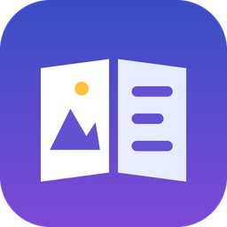

# Ellview

꿀뷰의 편한 조작감에 NeeView처럼 움직이는 이미지·초대형 이미지까지 볼 수 있게 만든 Windows용 이미지/만화 뷰어입니다.



## 주요 기능

| 분류 | 내용 |
|---|---|
| 열기 | 폴더, 이미지 파일, 압축파일(ZIP·CBZ / 7Z·CB7 / RAR·CBR / TAR·TAR.GZ), 끌어다 놓기, "연결 프로그램"으로 열기 |
| 압축 | 풀지 않고 바로 읽기, 한글(CP949) 파일명 zip 복원, 하위 폴더 포함, 암호 압축 지원, 확장자가 틀려도 내용으로 판별 |
| 이미지 | JPG · PNG · GIF · WebP · APNG · AVIF · HEIC · BMP · TIFF · PSD · TGA · ICO 등 |
| 움직이는 이미지 | GIF · WebP · APNG · AVIF 애니메이션 재생 (큰 GIF도 프레임을 스트리밍으로 재생), `P`로 일시정지 |
| 대용량 | 설정한 크기(기본 120MP)보다 큰 사진은 축소 디코딩해서 메모리 폭발 없이 표시 |
| 이동 | 휠·방향키·PgUp/PgDn·Space·화면 양 끝(5분의 1) 클릭(마우스를 올리면 화살표 표시), 넘치는 이미지는 스크롤 후 다음 장 |
| 파일 이동 | `[` `]` 또는 `Ctrl+←/→`로 이전/다음 파일의 첫 페이지로 바로 이동. 휠·방향키로는 넘어가지 않고 끝에서 알림만 (설정에서 "안내 후 이동"·"바로 이동"으로 바꿀 수 있음) |
| 책갈피 | 경로 + 페이지로 저장. 파일을 옮기거나 이름을 바꿔도 지문으로 다시 찾아 경로 자동 수정 |
| 이어보기 | 책마다 마지막 페이지 기억, 최근 파일 목록 |
| 보기 | 창/가로/세로 맞춤, 원본, 확대·축소(Ctrl+휠), 두 페이지 보기, 오른쪽→왼쪽(만화), 표지 단독, 가로 이미지 단독 |
| 편의 | 썸네일 목록, 이미지 정보 표시, 전체 화면, 다크 테마, 단축키 변경, 업데이트 알림 |
| 회전/반전 | 90° 회전, 좌우 반전 — 프로그램을 끌 때까지 모든 페이지에 유지 |
| 복사 | 지금 이미지 또는 경로(`압축파일 > 내부경로`)를 클립보드로 |
| 슬라이드쇼 | 간격 설정, 책 끝에서 다음 파일로 이어가기 / 반복 / 멈춤 |
| 탐색기 메뉴 | 설정에서 켜면 폴더·이미지·압축파일 우클릭에 "Ellview로 열기" |

## 사용하기

1. [Releases](../../releases)에서 `Ellview-x.y.z-win64.zip`을 받아 원하는 곳에 압축을 풉니다.
2. `Ellview.exe`를 실행합니다. 설치가 필요 없습니다.
3. 이미지/압축파일을 기본 프로그램으로 쓰려면: 파일 우클릭 → 연결 프로그램 → 다른 앱 선택 → `Ellview.exe`.

### 포터블 모드
`Ellview.exe` 옆에 빈 파일 `portable.txt`를 만들면 설정·책갈피가 `%APPDATA%\Ellview` 대신 같은 폴더의 `data\`에 저장됩니다. USB에 넣고 다닐 때 좋아요.

### RAR 파일
릴리스 zip의 `tools\`에 7-Zip(`7z.exe`, `7z.dll`)이 들어 있어 RAR을 바로 열 수 있습니다. 직접 빌드했다면 7-Zip 설치 폴더의 두 파일을 `tools\`에 복사하거나 `UnRAR.exe`를 넣어주세요. 없으면 Windows 내장 `tar.exe`로 시도합니다.

## 단축키 (기본값)

| 동작 | 키 |
|---|---|
| 다음 / 이전 페이지 | `→` `PgDn` `Space` / `←` `PgUp` `Backspace` |
| 스크롤 (끝이면 페이지 이동) | `↓` / `↑` |
| 한 장만 이동 | `Shift+→` / `Shift+←` |
| 처음 / 마지막 | `Home` / `End` |
| 다음 / 이전 파일 (첫 페이지부터) | `]` `Ctrl+→` / `[` `Ctrl+←` |
| 안내 확인 ("안내 후 이동" 모드에서) | `Enter` |
| 페이지로 이동 | `Ctrl+G` |
| 창 / 가로 / 세로 맞춤 / 원본 | `Ctrl+1` / `Ctrl+2` / `Ctrl+3` / `Ctrl+4` |
| 확대 / 축소 | `+` `Ctrl+=` / `-` `Ctrl+-`, `Ctrl+휠` |
| 두 페이지 / 오른쪽→왼쪽 | `D` / `M` |
| 전체 화면 | `F11` `Alt+Enter` 더블클릭, 해제 `Esc` |
| 썸네일 / 정보 / 애니메이션 정지 | `T` / `I` / `P` |
| 오른쪽 / 왼쪽 회전, 좌우 반전 | `Ctrl+R` / `Ctrl+Shift+R`, `H` |
| 슬라이드쇼 시작/정지 | `S` (`Esc`로도 정지) |
| 이미지 / 경로 복사 | `Ctrl+C` / `Ctrl+Shift+C` |
| 책갈피 추가 / 목록 | `Ctrl+D` / `Ctrl+B` |
| 설정 / 단축키 목록 | `Ctrl+,` / `F1` |

모든 단축키는 **설정 → 단축키**에서 바꿀 수 있습니다.

## 데이터 위치

- 일반: `%APPDATA%\Ellview\` (`settings.json`, `bookmarks.json`, `history.json`, `error.log`)
- 포터블: `Ellview.exe` 옆 `data\`
- 7z 임시 캐시: `%TEMP%\Ellview_cache` (3일 지나면 자동 정리)

책갈피 파일은 사람이 읽을 수 있는 JSON이라 백업·이동이 쉽습니다.

---

## 개발

```powershell
python -m venv .venv
.venv\Scripts\activate
pip install -r requirements-dev.txt
python run.py                 # 실행
python -m pytest -q           # 테스트
python scripts/build.py       # dist\Ellview\Ellview.exe + 배포용 zip
```

### 폴더 구조

```
ellview/
  __init__.py        버전, GitHub 저장소(업데이트 확인용)
  app.py             시작점 (예외 로그, 번역, 테마)
  config.py          설정 파일/저장 위치/포터블 모드 (새 설정은 DEFAULTS에 추가)
  core/              ── 화면과 무관한 로직 (단독 테스트 가능)
    formats.py       지원 확장자, 자연 정렬
    archives.py      압축 백엔드 (register_backend로 형식 추가)
    books.py         책(폴더/압축) 추상화, 다음/이전 책 찾기
    loader.py        디코딩, 캐시, 백그라운드 미리 읽기
    spread.py        두 페이지 배치 계산
    bookmarks.py     책갈피 + 재탐색
    history.py       최근 파일, 이어보기
    updater.py       GitHub Releases 최신 버전 확인
  ui/                ── 화면
    main_window.py   메뉴/동작 연결 (act_<동작이름> 메서드)
    viewer.py        이미지 그리기, 확대/스크롤/클릭/휠
    animation.py     GIF/WebP/APNG 재생
    thumbnails.py    썸네일 패널
    dialogs.py       설정, 책갈피, 도움말
    shortcuts.py     동작 목록과 기본 단축키
    theme.py         다크/라이트 테마
tests/               pytest (오프스크린 GUI 테스트 포함)
scripts/             build.py, make_icon.py, screenshot.py
```

### 기능 추가하는 법

- **새 단축키 동작**: `ui/shortcuts.py`의 `ACTIONS`에 한 줄 추가 → `MainWindow`에 `act_<id>` 메서드 작성. 메뉴, 설정의 단축키 표, 도움말에 자동 반영됩니다.
- **새 압축 형식**: `core/archives.py`에 `ArchiveBackend` 하위 클래스 작성 → `register_backend("이름", 클래스)` → `formats.ARCHIVE_EXTS`에 확장자 추가.
- **새 이미지 형식**: Pillow 플러그인을 설치하고 `formats.IMAGE_EXTS`에 확장자 추가 (`loader.py`가 Qt → Pillow 순으로 시도).
- **새 설정**: `config.DEFAULTS`에 기본값 추가. 기존 사용자의 설정 파일과 자동 병합되므로 업데이트해도 깨지지 않습니다.

### 릴리스 (배포) 절차

1. `ellview/__init__.py`의 `__version__`을 올립니다 (예: `0.2.0`).
2. `CHANGELOG.md`에 변경 내용을 적습니다.
3. 커밋 후 태그를 푸시합니다.
   ```bash
   git commit -am "release: v0.2.0"
   git tag v0.2.0
   git push origin main --tags
   ```
4. GitHub Actions가 테스트 → exe 빌드 → 실행 확인 → Releases에 zip 업로드까지 자동으로 합니다.

처음 한 번만: `ellview/__init__.py`의 `GITHUB_REPO = "내아이디/Ellview"`를 채워두면 앱이 시작할 때 새 버전을 알려줍니다.

## 라이선스

MIT (LICENSE 참고). 사용 라이브러리: PySide6(LGPL), Pillow, pillow-heif, py7zr, rarfile. 동봉되는 7-Zip은 7-Zip 라이선스(LGPL + unRAR 제한)를 따릅니다.
